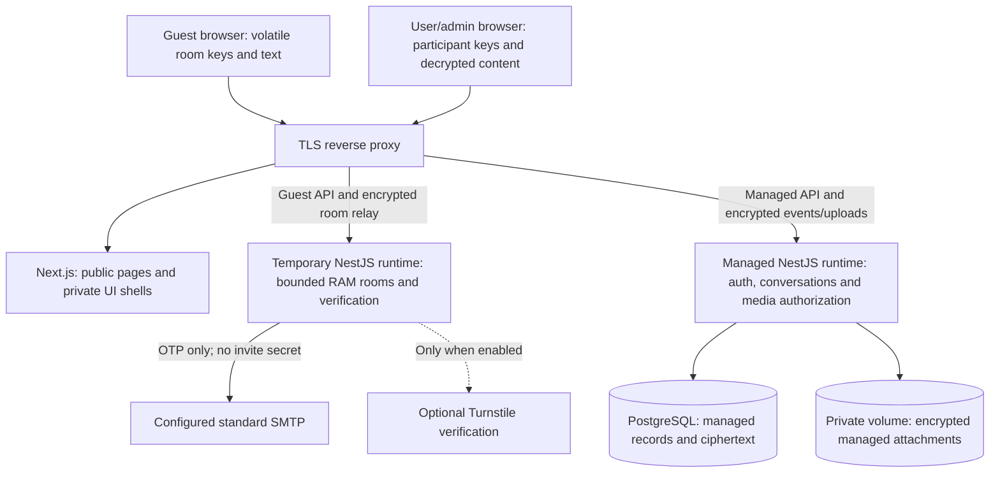

# Sirr Software Architecture Document

| Field | Value |
|---|---|
| Version | 0.1.0 |
| Date | 2026-11-25 |
| Status | Proposed architecture for review |
| Requirements | [SRS](../requirements/SRS.md), [PRD](../requirements/PRD.md) |
| Decisions | [Public decision register](../planning/DECISIONS.md) |
| Delivery sequence | [Roadmap](../planning/ROADMAP.md) |

## 1 Architecture drivers

Sirr needs two different data lifecycles within one maintainable public codebase. Temporary group text cannot depend on durable queues, history or database recovery. Managed conversations require durable ciphertext, authorized history and private attachments. Arabic/English, resource limits, portable Docker deployment and independence from mandatory BaaS are cross-cutting constraints.

The recorded stack direction is TypeScript, Next.js App Router, custom NestJS, PostgreSQL and Docker Compose. This document proposes how those components cooperate. It does not approve a cryptographic protocol, an ORM, a hosting vendor or an application scaffold. Existing AGPL v3 licensing and enabled-by-default public email verification are owner-confirmed decisions.

## 2 Proposed system boundaries

Use a modular backend codebase with separate managed and temporary runtime entry points as the preferred production candidate. This keeps development shared while giving the temporary process no database credentials, database network path or media volume. DEC-06 remains open because this costs an extra process and deployment configuration.

The diagram shows a proposed runtime boundary, not a deployed topology. Browser-to-proxy connections require TLS; internal service networking and remote services need explicitly defined trust/TLS policies. SMTP and optional CAPTCHA are outside Sirr's content boundary and may observe verification metadata. The temporary runtime never receives conversation decryption keys under the E2EE design target.

An operator may access infrastructure or stop a service without becoming a participant. A malicious operator serving altered client code can undermine browser E2EE. Separate processes reduce accidental persistence and compromise reach; they do not remove that client-delivery trust assumption.

## 3 Component responsibilities

| Component | Responsibilities | Data and restrictions |
|---|---|---|
| Web client | Public localization/SEO, room/chat/admin UI, client crypto, key UX, voice/media preparation, authorized decryption | Decrypted private content stays client-side. Do not send it to SSR, telemetry, server actions or public caches. Temporary keys/history never use durable browser storage. Persistent key storage requires DEC-02. |
| Next.js runtime | Public SSG/SSR, localized metadata, UI delivery and public runtime configuration | No duplicate domain backend, database access or room plaintext. Private UI shells use no-store/noindex as applicable; authorization remains in backend. Static export is an option only after route/runtime feasibility. |
| Temporary runtime | Creation verification, room capability validation, membership, expiry, bounded ciphertext forwarding | In-memory rooms/counters only in this candidate; no ORM, DB credentials, disk queues, media mounts or event recovery. SMTP credential access is distinct from DB access. |
| Managed runtime | Account/session/MFA services, provisioning, memberships, history, message acceptance, quota and attachment authorization | Stores managed metadata and ciphertext, not unwrapped content keys. Audit excludes content and credentials. |
| PostgreSQL | Managed identities, sessions, conversations, message/attachment references, permitted audit and settings | Constraints/migrations enforce invariants. No temporary room/message tables or permanent email-to-room relation. |
| Private media store | Bounded staged and committed ciphertext objects | Outside public web root; downloads/ranges only through authorized backend. No plaintext transcoding requirement. |
| Reverse proxy | TLS, routing, bounded request handling and trusted forwarding | Redact sensitive URLs/headers; disable private content caching and body logging. Do not persist room forwarding through proxy buffers. |

### Proposed module and package organization

Future web and backend applications may use `apps/web` and `apps/server`, with managed and temporary bootstrap entry points inside the server project. An ADR must settle build/output structure before scaffolding. Separate runtime processes do not imply separate repositories or independently evolving domain services.

Backend boundaries: configuration/security, temporary rooms, verification/rate limits, authentication/users/admin, conversations/messages, attachment/quota/storage, SMTP and managed database. Temporary modules must not import persistence providers. Enforce this with import checks and runtime network/mount tests.

Potential shared packages cover protocol envelopes, crypto adapters, API contracts/validation, localization and client media preparation. Create packages only when real boundaries justify them. Do not expose private server configuration through shared frontend modules. Mobile may reuse contracts/locales and compatible protocol adapters later; browser APIs are not assumed to work unchanged on mobile.

## 4 Core data flows

### 4.1 Temporary room creation and messaging

1. Guest selects locale/lifetime and requests verification. The temporary runtime checks configured rate, pending-challenge and email budgets before SMTP work. Public default requires verification; explicit operator override is supported.
2. SMTP delivers only the OTP. The runtime validates a protected, short-lived single-use challenge and authorizes bounded room allocation. With verification enabled, mail failure cannot fall back to unverified creation.
3. Successful allocation returns room coordination information and a separate owner capability. Participant key material and invitation construction follow the selected protocol. Proposed invitation secrets use a URL fragment; review frontend/proxy/referrer/history behavior before accepting this design. A fragment can still enter browser history or session restore; consuming it and replacing the URL is only a candidate mitigation, not proof of physical erasure. Resolve this tension with temporary non-persistence under DEC-14. Never put decryption secrets into query strings or email.
4. Invitees validate/join protocol membership, authenticate relevant participant keys and exchange ciphertext through the relay. A server-recognized capability alone does not solve malicious key substitution.
5. Each operation checks membership, state, deadline and resource limits. Forward only to currently eligible connected participants; no historical replay, offline queue or Socket.IO state recovery for sensitive events.
6. Expiry/owner termination stops forwarding and clears RAM state. Compliant connected clients clear history/key references. A disconnect/restart has documented loss behavior; it does not invoke durable room recovery.

Proposed RAM rate counters reset on process restart. That is an abuse-control trade-off, not a security guarantee. A distributed coordinator is deferred. DEC-07 must settle retention, retries and restart semantics before public deployment; persistent email-to-room associations remain forbidden.

### 4.2 Managed authentication and provisioning

Administrator bootstrap must be out of band or another explicitly reviewed process with no shared default password. Administrator provisions temporary user credentials; first login restricts access to required credential changes. Review MFA enrollment, backup codes, reset authority and administrator key recovery together. None is implemented.

Proposed mechanisms are Argon2id password hashing, short-lived access authentication and rotating/revocable refresh sessions, with TOTP as an MFA candidate. Parameters and token/cookie transport remain DEC-12. JWT example variable names do not mandate a JWT-based design.

Every request and sensitive socket event validates current account/session eligibility and conversation membership. Disabling an account revokes sessions and live socket access. Credential reset and new-device enrollment must not silently grant historical keys. Session revocation does not erase copies already decrypted on a recipient device.

### 4.3 Persistent message acceptance

Prefer one canonical message command handler, whether reached through REST or sockets. A proposed operation identifier scoped to sender/conversation supports safe retries. The handler validates session, active status, membership, envelope version/size and quotas before persisting ciphertext transactionally. Acknowledgment means the documented durable state, never just receipt into memory.

After commit, notify currently connected authorized participants. On reconnect, clients query authorized durable history to repair missed live events. This avoids a mandatory message broker in the MVP. Database write and live notification are not assumed atomic; clients must tolerate a committed message whose notification was lost. Delivery/read receipts remain P1.

Opaque payload validation can enforce shape, version, byte count and sender authorization. Content authenticity is also verified by the participant's protocol implementation; the server cannot validate plaintext meaning.

### 4.4 Attachment and voice flow

The client records/selects media, attempts supported local optimization, previews and encrypts using the chosen protocol. Client checks for duration/type are usability controls, not trusted server policy. The backend reserves quota atomically, accepts bounded ciphertext streams and finalizes an authorized message-to-attachment relation.

A proposed storage lifecycle is `RESERVED -> STAGING -> COMMITTED`, with `ABORTED`/expired cleanup for failures. Filesystem operations and SQL commits are not a single transaction. A reconciliation process must recover both file-present/DB-missing and DB-present/file-missing cases without exposing broken attachments or charging abandoned reservations indefinitely. Orphan cleanup applies only to managed ciphertext, never temporary rooms.

Downloads authorize membership and stream bounded bytes. Authenticated chunking, range seeking and key/nonce rules come from the reviewed encryption design, not an invented storage protocol. A small whole-object decrypt may be simpler initially, but its memory, startup delay and seeking costs must pass DEC-08 tests on low-memory mobile browsers. No choice is approved yet.

## 5 Data model and invariants

This is a logical model; SQL schema and migrations follow protocol and recovery decisions.

| Managed entity | Proposed responsibility and invariant |
|---|---|
| User | Unique normalized username, password hash, role/status and first-login state. Username normalization/allowed characters need explicit specification. |
| Authentication session | Hashed revocable session/refresh material, expiry and device association; never plaintext passwords or refresh secrets. |
| Conversation | Administrator participant plus exactly one registered user; a uniqueness constraint prevents duplicate user conversations. Multi-admin reassignment is outside MVP. |
| Device/key records | Public device identity and protocol-required wrapped material only; enrollment/revocation/history access depend on DEC-01/02. Never assume server possession of a user's decrypting private key. |
| Message | Conversation/sender references, encrypted versioned envelope and stable ordering/pagination metadata; idempotency uniqueness per approved command contract. |
| Attachment | Authorized message/conversation relation, opaque storage identifier, ciphertext size/state and quota ownership; sensitive file metadata encrypted where protocol supports it. |
| Audit/settings | Minimal security events and validated operational settings with documented retention; no content, tokens or content keys. |

P1 receipts and account email/reset records are later additions unless needed for a separately approved P0 mechanism. Temporary rooms, messages, invite/owner capabilities and room-linked email addresses have no SQL model. Aggregate operational telemetry must not recreate temporary history or membership records.

Use explicit migrations and constraints; no automatic production schema synchronization. TypeORM with `pg` is the current ORM proposal, not an accepted dependency. PostgreSQL authorization and application membership checks remain necessary regardless of optional row-level-security choices.

## 6 Encryption and key lifecycle decision gate

DEC-01 and DEC-02 must produce a reviewed design covering:

- Protocol/library versions, license compatibility, maintenance and browser/mobile support; separate assessment for ephemeral groups and persistent conversations if needed.
- Participant identity/key authentication, invite compromise, server key substitution, replay/ordering, concurrent sends and membership changes.
- Key generation, storage, enrollment, revocation, administrator device continuity and history access on new devices.
- Password change/reset, lost devices, lost administrator keys, recovery-secret custody and irreversible-loss UX.
- Message/attachment envelope versioning, authenticated metadata and streaming/seek integrity without ad hoc cryptography.
- Whether forward secrecy and post-compromise recovery are provided, and their precise limitations. Neither is promised by this draft.

Web Crypto supplies primitives, not this lifecycle. Do not invent a group protocol by combining encryption primitives. No plaintext server indexes, server plaintext transcoding or server-readable escrow may be added as an implementation shortcut. If a recovery proposal changes the provider-blind trust model, record that trade-off and obtain an explicit requirement decision.

## 7 Deployment and operations

### Reference deployment proposal

Docker Compose on one operator-controlled host, with web, managed runtime, temporary runtime, PostgreSQL and a reverse proxy. Caddy is proposed. Durable DB/media volumes belong only to managed services. Temporary runtime has bounded RAM and access only to required public proxy/SMTP/optional CAPTCHA paths, without a DB network path. Separate credentials/mount permissions must be tested rather than inferred from container names.

Use same-origin reverse-proxy routing as the preferred auth-simplicity candidate. Independently hosted frontend/backend remains a P0 supported-profile requirement; cross-origin cookie/token, CORS, CSRF and WebSocket origin behavior require an explicit alternative configuration and tests. Next.js SSR/static deployment and runtime public configuration must support the selected profiles without copying backend logic into the frontend.

Optional development profiles may add Mailpit or database inspection tools. Do not expose development consoles in production. No Redis/Valkey, durable event queue, Kubernetes, Kafka or independent storage service is required for the initial design. Multiple ephemeral replicas and seamless room failover are deferred; a single process owns a room's lifetime.

### Backup and migration

Coordinate database and managed media consistency; restore into a clean environment and verify attachment integrity plus participant decryption. Protect server configuration secrets separately and document the recovery material required by the chosen protocol. A server backup must not introduce unwrapped participant private keys. Recovery packages may require separate client custody; “backup everything together” is not authorization for server-readable key escrow.

Temporary state is excluded from backups and crash capture. Define snapshot consistency, backup encryption/access, restore steps, retention, deletion interaction and RPO/RTO before release. Changing endpoint environment variables does not move DB/media or recover participant keys.

### Observability and failure handling

Allow minimal aggregate health/resource measures and approved managed security audit events. Do not log message bodies, crypto envelopes, OTPs, capabilities, authentication headers or private URL fragments. Review reverse-proxy access logs, exception serialization, tracing, swap/core dumps and hosting-provider instrumentation under DEC-14. A no-room-table design alone does not establish non-persistence.

Readiness for the managed runtime depends on required DB/storage/configuration. Temporary readiness depends on valid limits and enabled verification dependencies, not PostgreSQL. Service restart ends temporary rooms and preserves managed ciphertext. Define graceful shutdown so stopped/expired rooms cannot keep forwarding and persistent writes are not acknowledged before commit.

## 8 Architecture alternatives and ADR candidates

The following are proposals to turn into ADRs after review; none is marked accepted.

| Candidate ADR | Decision reference | Alternatives and trade-off |
|---|---|---|
| ADR-001 Temporary isolation | DEC-06/14 | Shared runtime saves resources; separate bootstrap/runtime narrows DB/storage access and accidental persistence. Prefer separate production runtime if measured cost fits. |
| ADR-002 Temporary transport | DEC-01/03 | Encrypted WebSocket relay simplifies group fanout/deadlines but sees metadata; WebRTC introduces signaling/connectivity/TURN complexity. Neither transport replaces E2EE. |
| ADR-003 Protocol and recovery | DEC-01/02 | Evaluate established compatible protocols against authentication, group lifecycle, history and recovery. No protocol chosen. |
| ADR-004 Session and bootstrap model | DEC-12 | Evaluate same-origin cookies and split-origin alternatives, CSRF, refresh rotation, MFA recovery and bootstrap. No browser token store chosen. |
| ADR-005 Persistence and storage | DEC-08/15 | TypeORM/pg versus other controlled SQL approaches; canonical message commands, quota reservation and encrypted file retrieval. No schema/stream cipher selected. |
| ADR-006 Portable web deployment | DEC-03/12 | Next.js runtime versus validated static output; runtime public config, origin routing and image portability. No hosting vendor selected. |

## 9 Architecture validation and remaining documents

Before building features, validate the proposed process/import/network boundaries, exact deployment resource budget, protocol compatibility, recording formats, encrypted playback and auth origins. Validation work must be separately authorized after this planning phase. No proof of feasibility exists yet.

Next detailed specifications are the threat model and encryption/key-lifecycle design, accepted ADRs, API and WebSocket contracts, logical/physical database design, UI/use cases, deployment and testing plans. Each must cite SRS/PRD IDs. A documented unsupported requirement is a decision to revisit, not a reason to silently remove it.

| Version | Change |
|---|---|
| 0.1.0 | Initial proposed architecture derived from the SRS; process isolation and protocol decisions remain open. |
